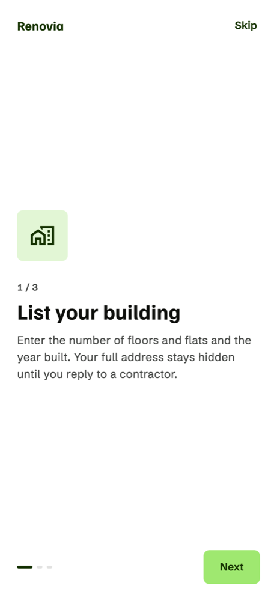
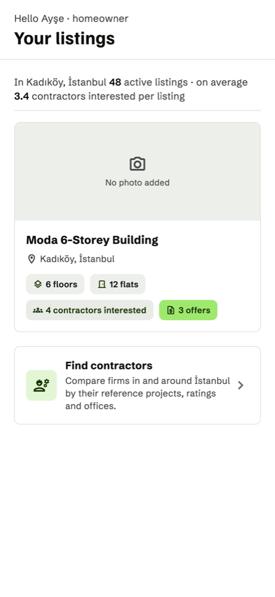
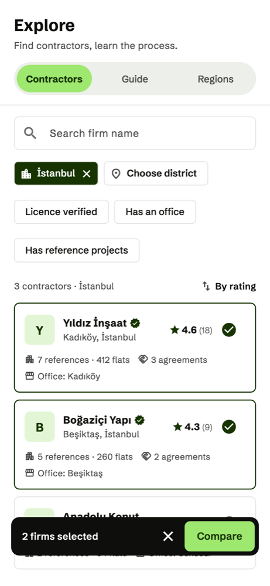
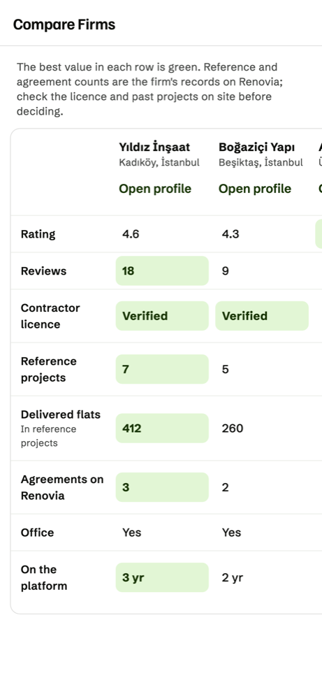
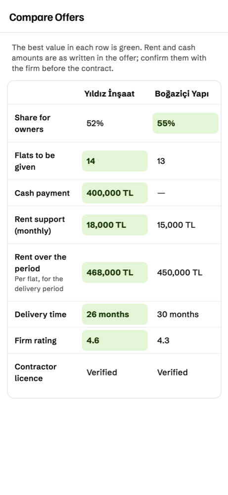
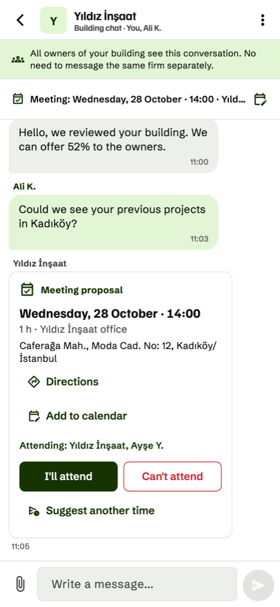
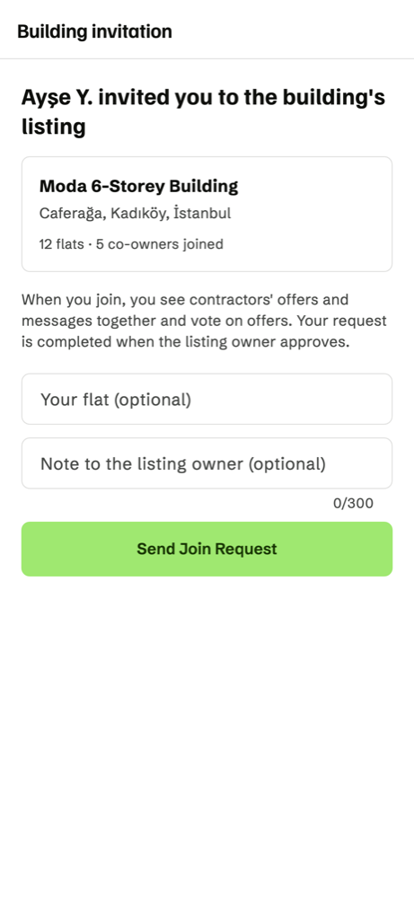
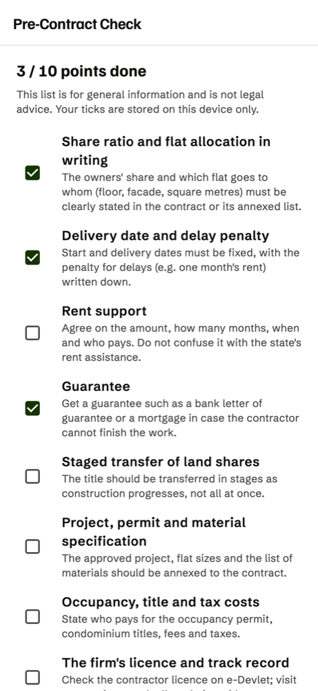
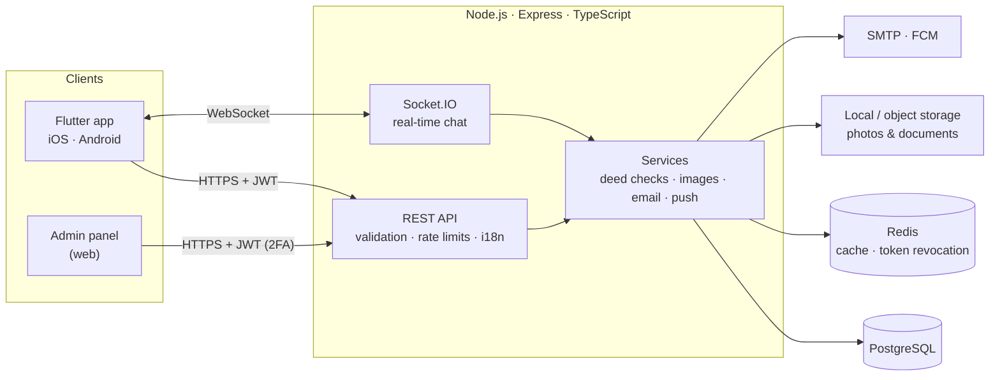

  

<h1 align="center">Renovia</h1>

  A mobile platform that brings together the owners of buildings facing urban transformation in Türkiye and the contractors who rebuild them. 
  Flutter · Node.js · TypeScript · PostgreSQL · Redis · Socket.IO

  <a href="https://wishyasin.github.io/renovia">Website</a>

> **About this repository.** Renovia is my graduation project. The source code lives in a private repository; this repo
> documents what the product does and how it is built. I'm happy to walk through the code in an interview.

## The problem

In Türkiye's urban transformation (*kentsel dönüşüm*), the owners of an old building must agree on a contractor who will
demolish and rebuild it in exchange for a share of the new flats (*kat karşılığı*). In practice:

- **Owners are scattered.** Neighbours talk to firms one by one, and the two-thirds majority needed for a decision is hard to reach.
- **Offers are hard to compare.** Every firm presents share ratio, number of flats, delivery time and rent support differently.
- **Trust is low.** Unlicensed firms, fake listings and "deposit" fraud are common.

Renovia puts one building in one listing: the owners see every offer and every message together, compare offers in the
same format and vote. Renovia never handles money between the parties.

## Screens

<table>
  <tr>
    <td align="center"> List your building</td>
    <td align="center"> Follow the process on one screen</td>
    <td align="center"> Find a contractor</td>
    <td align="center"> Compare firms</td>
  </tr>
  <tr>
    <td align="center"> Compare offers row by row</td>
    <td align="center"> One shared chat for all owners</td>
    <td align="center"> Invite neighbours with a link</td>
    <td align="center"> Check the contract before signing</td>
  </tr>
</table>

All people, firms and numbers in the screenshots are fictional.

## Features

**Homeowners**
- Create a building listing; the full address stays hidden until the owner replies to a contractor.
- Invite neighbours with a single link; the listing owner approves each join request.
- Receive flat-for-land offers in one format and compare them side by side, with the best value in each row highlighted.
- Vote on offers; every owner is notified when a two-thirds majority is reached.
- A shared conversation with each firm, with meeting proposals and a calendar.
- A 10-point checklist to review before signing a flat-for-land contract.

**Contractors**
- Browse verified listings by region and send structured offers.
- A public profile with reference projects, ratings and reviews from homeowners.

**Admins** (web panel served by the backend)
- Review queues for title deeds and contractor licences, with automated risk findings.
- Two-step login: a 6-digit code is emailed after the password check; only its hash is stored.

## Approach to trust

| Check | How it works |
|---|---|
| Title deed | A listing is not shown to contractors until its deed details and document are reviewed. Automated checks flag the same flat being listed twice and reused photos (a 64-bit perceptual hash, so a resized or re-saved copy still matches). Checks never decide on their own; findings go to an admin as risks. |
| Contractor | Tax number and contractor licence are reviewed; verified firms get a badge. |
| Privacy | The full address is shown only to the chosen firm; documents are visible only to the review team. Accounts can be deleted from the app, and their access tokens are revoked immediately. |

## Architecture

- **Mobile:** Flutter, about 26k lines of Dart. Turkish and English, built on a small design system
  (Familjen Grotesk and Schibsted Grotesk).
- **Backend:** Express with TypeScript, about 9.5k lines, organised as routes → controllers → services.
  The database schema is managed with 30 plain SQL migrations.
- **Auth:** short-lived JWT access tokens (15 min) with refresh tokens (7 days), bcrypt password hashes,
  token revocation in Redis when an account is deleted.
- **Hardening:** Helmet headers, rate limiting on API and auth routes, request validation, parameterised SQL.
- **Images:** uploads are re-encoded with `sharp` (thumbnails, EXIF/GPS stripped so a photo cannot leak a hidden
  address); deed and licence documents are kept in separate private storage.
- **Testing:** widget tests for the main flows (listings, offers, chat, account), and integration tests that drive the app against a
  real server and a separate demo database. The same integration tests record the product demo videos.

## Status

The app runs end-to-end against a local server: listings, deed and licence review, offers, voting, chat,
notifications and the admin panel all work. Before a public release it still needs production hosting, push
notification credentials, SMS verification and store listings.

## Author

**Yasin Özçelik** · [GitHub](https://github.com/wishyasin)
